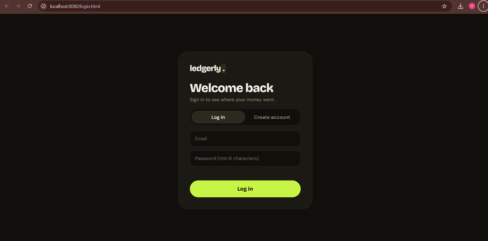
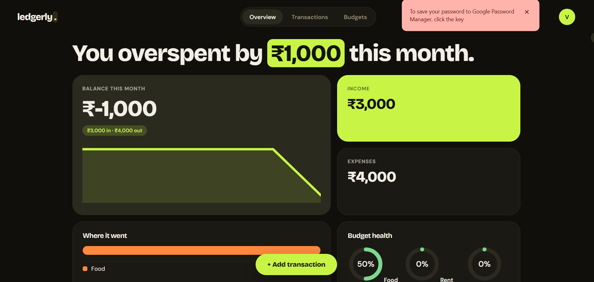
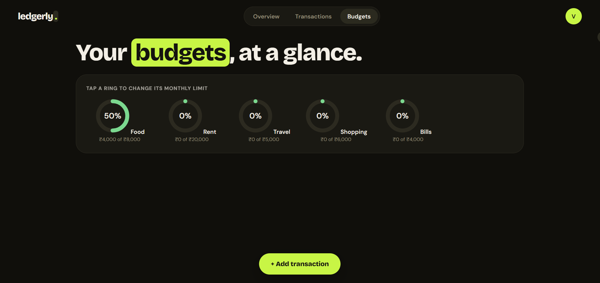
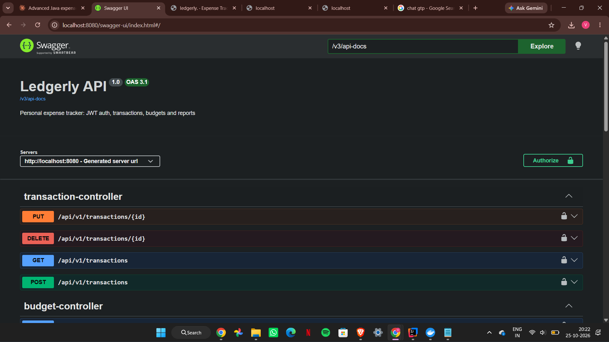
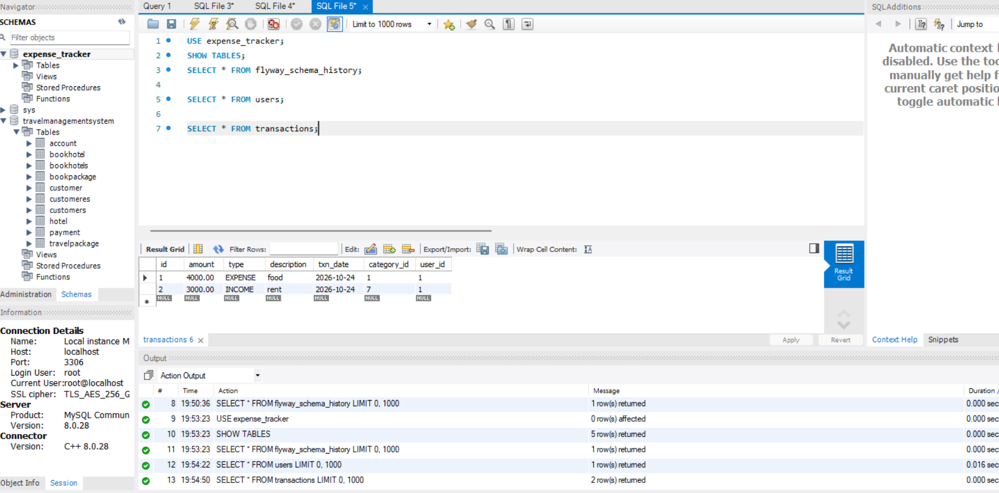
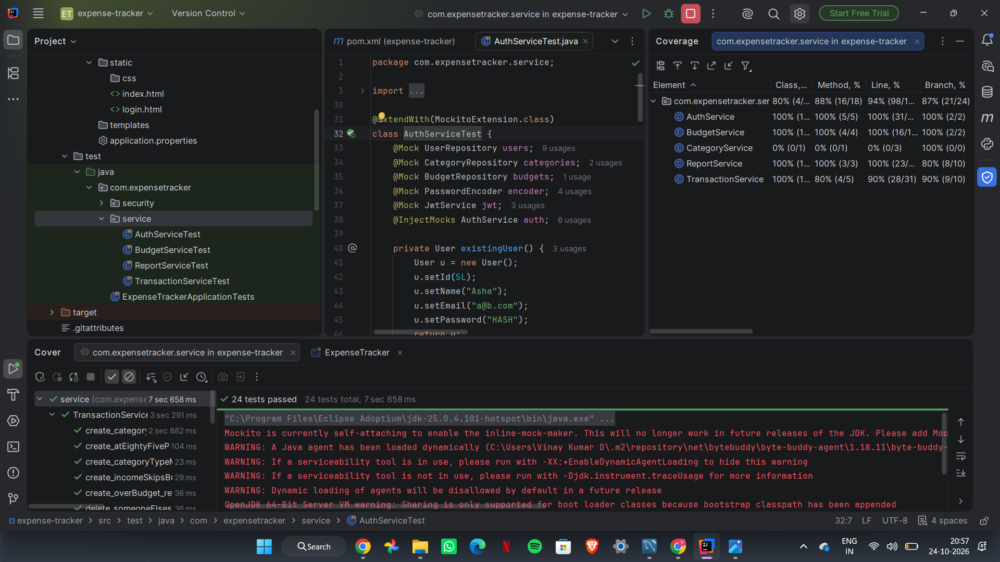
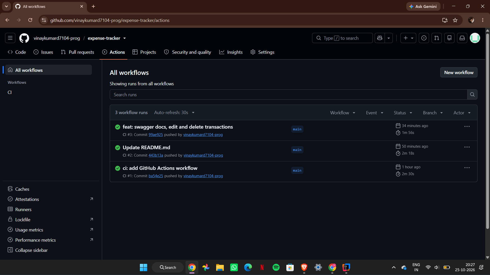

# ledgerly. – Expense Tracker

A full-stack personal finance app. Users register, log in, track income and expenses, set category budgets, and get alerts when a budget is nearly used up.

**Tech:** Java 21 · Spring Boot 4 · Spring Security + JWT · Spring Data JPA · MySQL · Flyway · Docker · GitHub Actions · Vanilla JS

## Features
- Secure sign-up and login with JWT and BCrypt-hashed passwords
- Every user sees only their own data
- Add, edit and delete transactions
- Budget alerts at 80% and 100% of a category limit
- Monthly analytics: balance, spending by category, 6-month trend
- Interactive API docs with Swagger UI
- Versioned database schema with Flyway migrations

## Screenshots

### Login


### Dashboard


### Budgets


### API documentation


### Database


### Service



### CI badge



## Run with Docker (one command)
```bash
cp .env.example .env        # then edit the values
docker compose up --build
```
Open http://localhost:8080 and create an account.

## Run locally
1. Start MySQL (the database is created automatically).
2. Set the environment variable `DB_PASSWORD` (optionally `JWT_SECRET`, 32+ characters).
3. Run `./mvnw spring-boot:run`, then open http://localhost:8080.

API docs: http://localhost:8080/swagger-ui.html

## API
All `/api/v1/**` endpoints need `Authorization: Bearer <token>`.

| Method | Path | Purpose |
|---|---|---|
| POST | /api/auth/register, /api/auth/login | Get a JWT |
| GET | /api/v1/categories | List categories |
| GET, POST | /api/v1/transactions | Paged list, create (returns budget alert) |
| PUT, DELETE | /api/v1/transactions/{id} | Edit, delete |
| GET, PUT | /api/v1/budgets | Budgets with spent and percent; set a limit |
| GET | /api/v1/reports/summary, /by-category, /trend | Analytics |

## Testing
30 unit tests (JUnit 5, Mockito) cover authentication, transactions, budgets and reports, with about 94% line coverage of the service layer. CI runs the full suite against a real MySQL on every push.

## Design notes
- Stateless JWT auth; every query is scoped to the logged-in user
- `BigDecimal` / `DECIMAL(12,2)` for money, DTO records, global exception handler
- `@EntityGraph` to avoid N+1 queries; composite index on `(user_id, txn_date)`
- Hibernate runs in `validate` mode; Flyway owns the schema